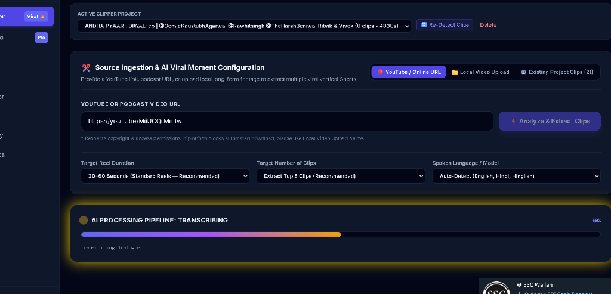
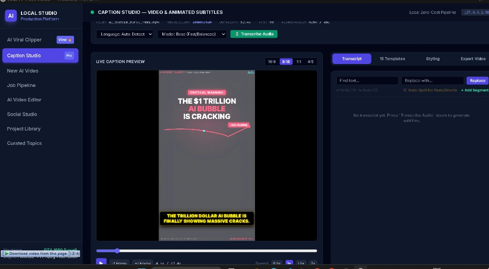
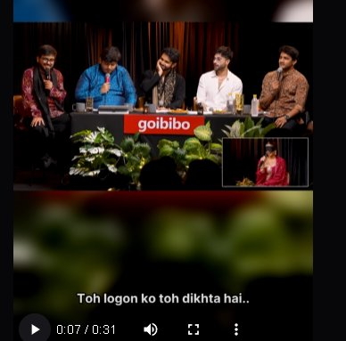
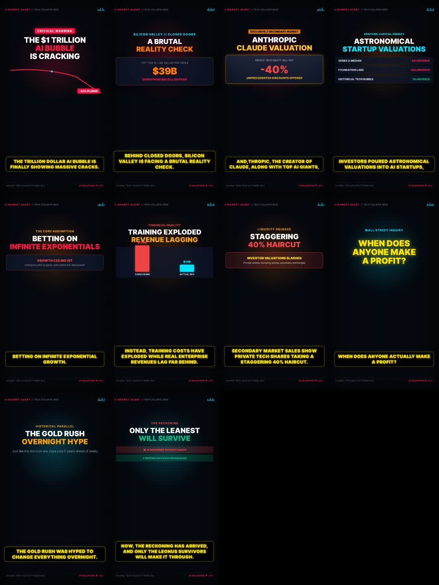
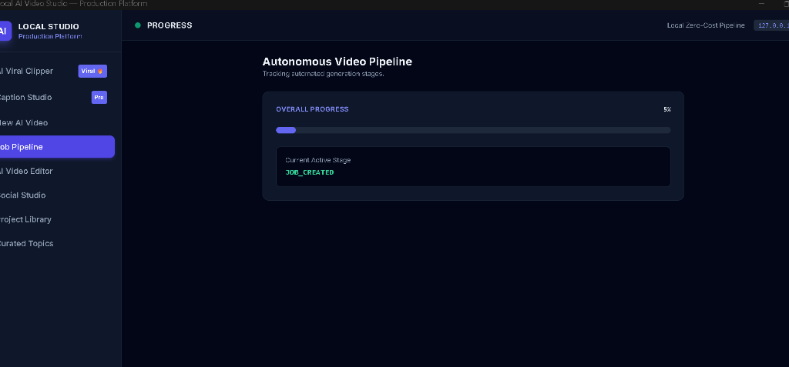

# Content-Creation-Hub — Local AI Video Production Studio

> **⚡ SINGLE COMMAND FULL SETUP (Clone, Install Everything & Launch):**
> 
> ```cmd
> git clone https://github.com/Ayushbunkar/Content-Creation-Hub.git && cd Content-Creation-Hub && .\setup.bat
> ```
> *Or in PowerShell:*
> ```powershell
> git clone https://github.com/Ayushbunkar/Content-Creation-Hub.git; cd Content-Creation-Hub; .\setup.bat
> ```
> *(Or simply download/clone the repo and double-click `setup.bat` in Windows File Explorer)*

[](https://microsoft.com/windows)
[](https://nodejs.org)
[](https://python.org)
[](https://remotion.dev)
[](#-zero-cost-local-ai-pipeline)

A production-grade, local-first, **100% zero-cost AI video creation, livestream clipping, and documentary production workstation**. 
Turn short topics or raw footage into fully researched investigative documentaries, viral vertical Shorts/Reels, kinetic typography captions, paper explainer reels, and livestream clips with chat velocity tracking — running entirely on your local machine with **zero paid external API tokens**.

---

## ⚡ 1-Click Single Command Setup (What It Does)

Running the single command above (`.\setup.bat`) automatically executes:
1. **Prerequisite Check**: Validates Node.js (v20+), Python (3.10+), and FFmpeg. If FFmpeg is missing, it installs it automatically via Windows `winget`.
2. **Node.js Environment**: Runs `npm install` for Remotion, React 19, Express, Lucide, and SQLite3.
3. **Python AI Environment**: Automatically provisions an isolated `.venv-tts` virtual environment and installs:
   - **OpenAI Whisper** (Speech-to-text with word-level timestamps & voice normalization)
   - **Kokoro TTS** (24kHz zero-cost studio voiceover synthesis)
   - **PyTorch** & audio toolkits
   - **yt-dlp** with Node.js runtime support
4. **Sound Design & Media Asset Initialization**:
   - Generates procedural SFX library (`whoosh`, `bass impact`, `page turn`, `camera shutter`, `newspaper impact`, `subtle riser`, `typing`, `digital interface`).
   - Generates copyright-safe background music (BGM) tracks with metadata.
   - Downloads streamer avatars for Indian and Global streamers.
5. **Windows Desktop App Integration**:
   - Creates a dedicated **`AI Video Studio`** shortcut icon directly on your Windows Desktop!
6. **Auto-Launch**: Starts the local server and opens the studio at `http://127.0.0.1:3000`.

---

## 📸 Studio Gallery & Project Interface

### 1. Stream Chat Viral Clipper (Live & VOD)
Real-time livestream clipping engine using a 5-minute rolling baseline chat velocity tracker. Automatically detects chat explosion moments, filters pre-stream countdowns, and extracts 9:16 vertical reels with guaranteed creator voice captions at the 3/4 position.



---

### 2. Caption Studio & Kinetic Typography
Live caption preview with 15 animated typography templates, auto-split timing, word-by-word active highlight synchronization, and non-linear search & replace across transcripts.



---

### 3. Vertical Shorts & Smart Reframing
Converts standard 16:9 widescreen footage into polished 9:16 vertical reels with Gaussian blur padding, smart speaker zoom, or center crop.



---

### 4. Topic-to-Documentary Production Engine (8-Min Full Production)
From a single prompt (e.g., *NVIDIA AI Dominance* or *US-China Semiconductor Race*), the engine conducts live web research, builds a verified Claim Ledger, plans structured JSON scenes, and renders documentary videos with animated maps and sound design.



---

### 5. Real-Time Pipeline Tracker & Built-In Minigame
Multi-stage autonomous pipeline tracking with WebSocket updates, progress bars, and an interactive **Flappy Bird** minigame to pass the time during local AI processing.



---

## 💎 Core Studio Modules

### 1. ⚡ Stream Chat Viral Clipper (`Stream Chat Clipper`)
- **5-Minute Rolling Baseline Velocity**: Accurately detects genuine chat spikes by comparing active message density against normal chat rate.
- **Pre-Stream / Countdown Screen Filter**: Discards intro screens ("Starting Soon", "Coming Soon", countdown timers) and waiting spam (`start karo`, `kab start hoga`, `waiting`). Only clips **after real action and creator commentary begin**.
- **Guaranteed Creator Spoken Captions**:
  - Voice normalization filter (`loudnorm=I=-16:TP=-1.5:LRA=11,highpass=f=80,lowpass=f=7500`) boosts creator speech by 12–15 dB above vehicle engines and gunshots.
  - Multi-script font support (`Segoe UI` / Devanagari) for Hindi, English, and Hinglish.
  - 3–4 word punchy viral style positioned at 3/4 screen height (`MarginV=450`) with bright yellow active-word highlight.
  - Zero fake chat text on video; only authentic creator commentary is burned.
- **Output Framing Controls**:
  - 🪟 *9:16 Gaussian Blur Pad* (10px subtle, 25px medium, 45px heavy)
  - 🔍 *9:16 Smart Speaker Zoom* (1.35x punch-in)
  - ✂️ *9:16 Direct Center Punch-in*
  - ⬛ *1:1 Square (Instagram Feed)*
  - 📺 *16:9 Original Widescreen*
- **Live Streamer Radar**: One-click selection for Top Indian Streamers (CarryisLive, Techno Gamerz, Total Gaming, Dynamo, Samay, Shub, Mortal, Jonathan, Tanmay, Scout) and Global Streamers.
- **Batch Render & Download**: Render and export all detected viral clips simultaneously in one click.

---

### 2. 📄 Paper Animation Studio & Explainer Reels (`Paper Studio`)
- **Handmade Paper-Cut Aesthetic**: Multi-layered physical paper cards, subtle drop shadows, fold creases, and tactile textures.
- **Stop-Motion Jitter & Camera Wiggle**: Procedural micro-jitter simulating real stop-motion frame capture.
- **Synchronized SFX**: Realistic paper sliding, paper flip, and cardboard placement sound effects.

---

### 3. 🏛️ Cinematic Documentary Production Engine (`Doc Engine`)
- **Intelligent Scene Planning Engine**: Generates structured JSON scenes based on semantic narration context (geopolitics receives genuine maps, finance receives charts, technology receives chip/hardware footage).
- **Genuine Geographical Datasets**: Natural Earth GeoJSON vector boundaries, animated nautical trade routes, capital markers, and smooth camera pans.
- **Sound Design System**: Dedicated audio ducking (music lowers during voiceover), bass impacts for key facts, whooshes for transitions, and risers for chapter climaxes.
- **Asset Licensing & Attribution**: Automatic attribution tracking for all public domain and Creative Commons media.
- **Automatic Quality Control (`qualityControlEngine.ts`)**: Validates that all narration segments, visual assets, subtitles, and audio tracks exist and are collision-free before final render.

---

### 4. ✍️ Caption Studio Pro (`Caption Studio`)
- **15 Production Subtitle Styles**: `minimal-white`, `bold-keyword`, `yellow-impact`, `news-lower-third`, `cinema-boxed`, `glow-neon`, `clean-condensed`, `karaoke-reveal`, `crimson-noir`, `emerald-finance`, `typewriter-mono`, `vintage-cream`, `social-reel-pop`, `minimal-subtle`, `duo-accent`.
- **Live Non-Linear Editor**: Find & replace names/words across the transcript with instant live preview update.
- **Aspect Ratio Switching**: Preview in 9:16 (Shorts), 16:9 (Landscape), 1:1 (Square), or 4:5 (Social Feed).

---

## 💰 Zero-Cost Local AI Pipeline

Everything runs entirely on your local machine with **$0 API costs**:

| Component | Technology | Cost | Location |
|---|---|---|---|
| **Voiceover Synthesis** | **Kokoro TTS (24kHz)** | **$0** | Local `.venv-tts` (CPU) |
| **Speech-to-Text** | **OpenAI Whisper (Base)** | **$0** | Local `.venv-tts` (CPU) |
| **Livestream Chat Ingestion** | **Direct HTML / VOD Crawler** | **$0** | Local Python Script |
| **Video Compositor** | **Remotion 4.0** | **$0** | Local Chromium Canvas |
| **Transcoding & Subtitle Burn** | **FFmpeg (with NVENC & libass)** | **$0** | Local Executable |
| **Fact-Checking & Research** | **Wikipedia & Wikimedia Commons API** | **$0** | Open Web Endpoints |
| **Database** | **SQLite3** | **$0** | Local `storage/database/studio.db` |

---

## ⚙️ System Requirements & Hardware Optimization

- **Operating System**: Windows 11 / Windows 10 (64-bit)
- **Processor**: Intel Core i5 / AMD Ryzen 5 (optimized for Ryzen 5 3550H / 24GB RAM)
- **RAM**: 16 GB DDR4/DDR5 recommended
- **Graphics Card**: NVIDIA GTX 1650 (4 GB VRAM) or higher
- **VRAM Contention Protection**: Kokoro TTS and Whisper run in `.venv-tts` isolated on CPU, leaving 100% of GPU VRAM free for Remotion's Chromium canvas compositor and NVENC encoding.

---

## 📂 Project Structure

```
├── public/                     # Static UI & compiled frontend assets
│   ├── index.html              # Studio interface with Stream Clipper & Framing controls
│   ├── audio/sound-effects/    # Procedural SFX library (whoosh, impact, paper-turn, etc.)
│   ├── audio/bgm/              # Generated ambient soundtrack library & metadata
│   └── streamers/              # Streamer avatars (Indian & Global)
├── server/                     # Backend API & pipeline orchestrators
│   ├── index.ts                # Express REST API & WebSocket server
│   ├── streamClipFinder.ts     # Stream chat clipper, framing & caption burner
│   ├── scenePlanningEngine.ts  # Intelligent structured JSON scene planner
│   ├── soundDesignSystem.ts    # Audio ducking, SFX placement & volume automation
│   ├── qualityControlEngine.ts # Pre-render project validator
│   ├── paperStudio.ts          # Paper-cut explainer reel synthesizer
│   ├── documentaryResearch.ts  # Live web research & Claim Ledger service
│   ├── viralClipper.ts         # YouTube/podcast clipper & viral detector
│   └── captionStudio.ts        # Subtitle styling & kinetic caption engine
├── src/                        # Remotion React video compositions
│   ├── Root.tsx                # Remotion composition registry
│   ├── compositions/           # CinematicDocumentary, PaperExplainerReel, CaptionedClip
│   └── subtitles/              # 15 Kinetic typography templates
├── scripts/                    # Python audio, voice & crawler scripts
│   ├── stream_chat_crawler.py  # Livestream chat crawler & velocity spike detector
│   ├── generate_clip_captions.py # Whisper voice extractor & 3/4 ASS subtitle generator
│   ├── streamer_radar.py       # Live streamer status radar
│   ├── generate_sfx_library.py # Procedural SFX generator
│   └── generate_bgm.py         # Synthesizes BGM soundscapes
├── setup.bat                   # 1-Click automatic installation script
├── AI-Video-Studio.bat          # Desktop app window launcher
├── requirements.txt            # Python AI dependency manifest
└── package.json                # Node dependencies & project scripts
```

---

## 🖥️ Running the Studio Anytime

Once setup is complete, you can launch the Studio through any of these methods:

- **Desktop App Icon**: Double-click the **`AI Video Studio`** shortcut on your Windows Desktop.
- **Command Line**: Run `npm run desktop` or `.\AI-Video-Studio.bat`.
- **Web Browser**: Run `npm run studio` and visit `http://127.0.0.1:3000`.

---

## 📜 Export Deliverables

Every generated project exports clean, production-ready deliverables:
- **1080p MP4 Video**: Rendered at 30 FPS H.264/AAC with ducked audio and custom typography.
- **SRT & ASS Subtitles**: Word-accurate timestamps with active highlight styling.
- **WAV Narration**: 24kHz studio-quality voiceover audio track.
- **Investigative Dossier (`.md`)**: Full research summary, chronological event timeline, and structured fact-check claim ledger.
- **Asset Manifest (`.json`)**: List of all Wikimedia Commons, archival, and stock assets with license and attribution details.

---

## 🤝 Contributing & License

Pull requests and issues are welcome! Feel free to fork the repository, propose new caption animation templates, or add new category workflows. Distributed under the MIT License.
