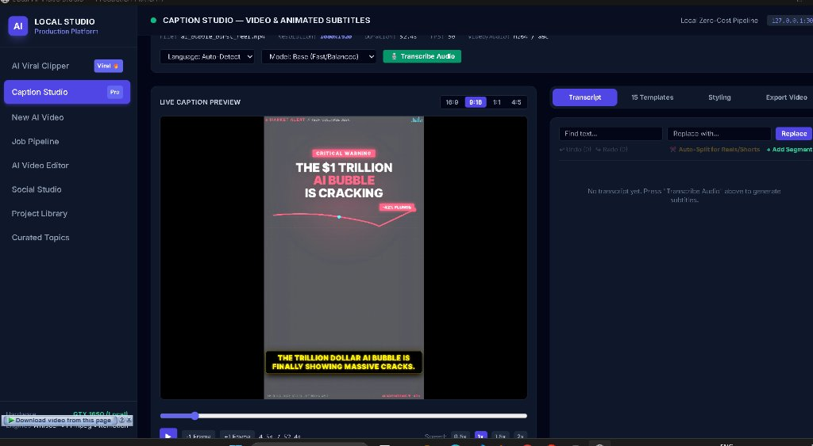
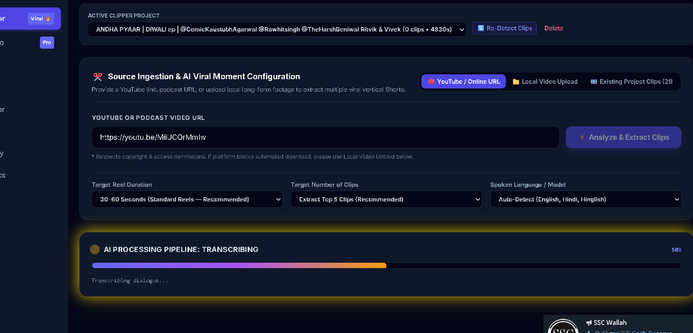
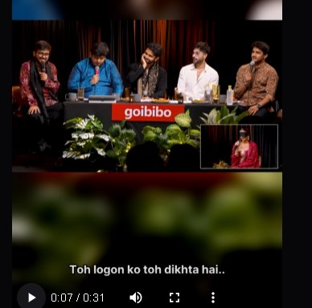
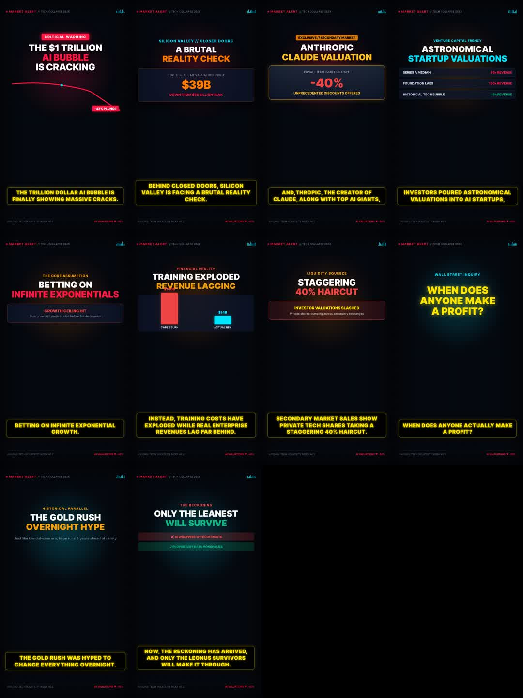
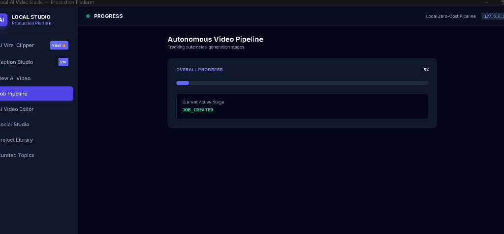

# Content-Creation-Hub — Local AI Video Studio

[](https://microsoft.com/windows)
[](https://nodejs.org)
[](https://python.org)
[](https://remotion.dev)
[](#-zero-cost-local-ai-pipeline)

A production-grade, local-first, **100% zero-cost AI video creation and automation workstation**. 
Turn short topics or raw footage into fully researched investigative documentaries, viral vertical Shorts/Reels, kinetic typography captions, and multi-track video explainers — running entirely on your local machine with **zero paid external API tokens**.

---

## 📸 Studio Gallery & Project Interface

### 1. Caption Studio & Animated Typography
Live caption preview with 15 animated kinetic templates, auto-split timing, word-by-word highlight synchronization, and non-linear text replacements.



---

### 2. AI Viral Clipper & Moment Detection
Ingest long-form YouTube URLs, podcast links, or local footage. The AI pipeline transcribes, scores hooks and retention, and automatically extracts the top viral clips.



---

### 3. Vertical Shorts & Smart Reframing
Converts standard 16:9 widescreen footage into polished 9:16 vertical reels with blurred cinematic background letterboxing, centered speaker detection, and burned animated captions.



---

### 4. Topic-to-Documentary Studio (8-Min Full Production)
From a single prompt or executive name (e.g., *NVIDIA Blackwell Architecture* or *Semiconductor Geopolitics*), the system executes live web research, builds a verified Claim Ledger, and writes an 8-chapter documentary with timed storyboard cuts.



---

### 5. Real-Time Pipeline Tracker & Built-In Minigame
Multi-stage autonomous pipeline tracking with WebSocket updates, stage indicators, and an interactive **Flappy Bird** minigame to pass the time during local AI transcription.



---

## ⚡ 1-Click Setup (Clone & Run Instantly)

If you just cloned this repository from GitHub, run the single-click automatic installer:

```bat
.\setup.bat
```
*(Or simply double-click `setup.bat` in Windows File Explorer)*

### What `setup.bat` does automatically:
1. **Verifies Prerequisites**: Checks Node.js, Python, and FFmpeg (automatically installs FFmpeg via `winget` if missing).
2. **Installs Node Modules**: Runs `npm install` for all Remotion, React, Express, and SQLite dependencies.
3. **Configures Python AI Environment**: Automatically creates `.venv-tts` and installs Whisper (speech-to-text), Kokoro TTS (voiceover), Torch, and `yt-dlp` from `requirements.txt`.
4. **Initializes Audio & Stock Assets**: Prepares database schemas, folders, and generates studio background ambient music.
5. **Creates Windows Desktop App Shortcut**: Generates a native **`AI Video Studio`** icon directly on your Windows Desktop!
6. **One-Key Launch**: Asks if you want to launch the desktop app immediately.

---

## 🖥️ Running the Studio Anytime

Once setup is complete, you can start the Studio through any of these methods:

- **Desktop App Icon**: Double-click the **`AI Video Studio`** shortcut on your Windows Desktop (opens in a standalone native desktop window).
- **Command Line**: Run `npm run desktop` or `.\AI-Video-Studio.bat`.
- **Web Browser**: Run `npm run studio` and visit `http://127.0.0.1:3000`.

---

## 💎 Core Studio Modules

### 1. 🎞️ AI Viral Clipper (`AI Viral Clipper`)
- **Direct Source Ingestion**: Paste any YouTube link, podcast URL, or upload local video files (`.mp4`, `.mov`, `.mkv`, `.webm`).
- **Viral Moment Analysis**: Evaluates hook strength, emotional resonance, and retention pacing to select the top 5 clips.
- **Smart 9:16 Reframing**: Crops and blurs background padding for vertical platforms (TikTok, Instagram Reels, YouTube Shorts).
- **Burned Kinetic Captions**: Hardcoded, stylized word-level subtitles timed to speech.

### 2. 🏛️ Topic-to-Documentary Studio (`8-Min AI Doc`)
- **Minimal User Input**: Enter only a single person's name, technology brief, or event topic.
- **Live Web Research & Fact-Checking**: Automatically searches Wikipedia, Wikimedia Commons, and news archives.
- **Claim Ledger**: Categorizes claims into `verified`, `reported`, `alleged`, `disputed`, and `unverified` with safe journalistic wording.
- **8-Chapter Story Arc**:
  1. *The Hook & Opening Teaser*
  2. *Strategic Stakes & Modern Context*
  3. *The Key Players & Organizations*
  4. *Chronological Timeline of Events*
  5. *Technical Mechanisms & Operations*
  6. *Counterpoints, Denials & Disputed Claims*
  7. *Wider Geopolitical & Economic Ripple Effects*
  8. *The Verdict & Future Synthesis*
- **Storyboard Engine**: Produces 80–100 granular 3–5s cuts with camera movements (`dolly_in`, `pan_left`, `orbit`) and audio SFX cues.
- **Review Mode vs One-Click Mode**: Option to pause and edit narration/claims before video rendering.

### 3. ✍️ Caption Studio (`Caption Studio Pro`)
- **15 Production Subtitle Styles**:
  - `minimal-white`, `bold-keyword`, `yellow-impact`, `news-lower-third`, `cinema-boxed`, `glow-neon`, `clean-condensed`, `karaoke-reveal`, `crimson-noir`, `emerald-finance`, `typewriter-mono`, `vintage-cream`, `social-reel-pop`, `minimal-subtle`, `duo-accent`.
- **Live Non-Linear Editor**: Find & replace names/words across the transcript with instant live preview update.
- **Aspect Ratio Switching**: Preview in 9:16 (Shorts), 16:9 (Landscape), 1:1 (Square), or 4:5 (Social Feed).

### 4. 🗺️ Geopolitics & Tactical Map Engine
- Procedurally generated SVG vector maps using Natural Earth geographic boundary data.
- Animated nautical chokepoint telemetry, military tactical arrows, trade route trajectories, and capital pins.

---

## 💰 Zero-Cost Local AI Pipeline

Everything runs entirely on your local machine with **$0 API costs**:

| Component | Technology | Cost | Location |
|---|---|---|---|
| **Voiceover Synthesis** | **Kokoro TTS (24kHz)** | **$0** | Local `.venv-tts` (CPU) |
| **Speech-to-Text** | **OpenAI Whisper (Base)** | **$0** | Local `.venv-tts` (CPU) |
| **Video Compositor** | **Remotion 4.0** | **$0** | Local Chromium Canvas |
| **Transcoding & Cuts** | **FFmpeg (with NVENC)** | **$0** | Local Executable |
| **Documentary Research** | **Wikipedia & Wikimedia Commons API** | **$0** | Open Web Endpoints |
| **Database** | **SQLite3** | **$0** | Local `storage/database/studio.db` |

---

## ⚙️ System Requirements & Hardware Optimization

- **Operating System**: Windows 11 / Windows 10 (64-bit)
- **Processor**: Intel Core i5 / AMD Ryzen 5 or higher
- **RAM**: 16 GB DDR4/DDR5 recommended
- **Graphics Card**: NVIDIA GTX 1650 (4 GB VRAM) or higher
- **VRAM Contention Protection**: Kokoro TTS and Whisper run in `.venv-tts` isolated on CPU, leaving 100% of GPU VRAM free for Remotion's Chromium canvas compositor and NVENC encoding.

---

## 📂 Project Structure

```
├── public/                     # Static UI & compiled frontend assets
│   ├── index.html              # Single-page studio interface & player
│   └── audio/bgm/              # Generated ambient soundtrack library
├── server/                     # Backend API & pipeline orchestrators
│   ├── index.ts                # Express REST API & WebSocket server
│   ├── pipeline.ts             # Autonomous video generation workflow
│   ├── documentaryResearch.ts  # Live web research & Claim Ledger service
│   ├── documentaryNarrative.ts # 8-chapter investigative script engine
│   ├── viralClipper.ts         # YouTube/podcast clipper & viral detector
│   ├── captionStudio.ts        # Subtitle styling & kinetic caption engine
│   └── db.ts                   # SQLite schema, tables & migrations
├── src/                        # Remotion React video compositions
│   ├── Root.tsx                # Remotion composition registry
│   ├── compositions/           # CinematicDocumentary & CaptionedClip
│   └── subtitles/              # 15 Kinetic typography templates
├── scripts/                    # Python audio, voice & helper scripts
│   ├── generate_bgm.py         # Synthesizes BGM soundscapes
│   ├── transcribe_words.py     # Whisper word-level timing extractor
│   └── create_desktop_shortcut.ps1 # Windows Desktop shortcut generator
├── storage/                    # Local asset persistence (gitignored)
│   ├── database/               # studio.db SQLite database
│   ├── clips/                  # Extracted vertical viral shorts
│   └── documentary_assets/     # Downloaded CC/Public Domain images
├── setup.bat                   # 1-Click automatic installation script
├── AI-Video-Studio.bat          # Desktop app window launcher
├── requirements.txt            # Python AI dependency manifest
└── package.json                # Node dependencies & project scripts
```

---

## 📜 Export Deliverables

Every generated project exports clean, production-ready deliverables:
- **1080p MP4 Video**: Rendered at 30 FPS H.264/AAC with ducked audio and custom typography.
- **SRT Subtitles**: Word-accurate timestamps (`.srt` and `.txt`).
- **WAV Narration**: 24kHz studio-quality voiceover audio track.
- **Investigative Dossier (`.md`)**: Full research summary, chronological event timeline, and structured fact-check claim ledger.
- **Asset Manifest (`.json`)**: List of all Wikimedia Commons, archival, and stock assets with license and attribution details.

---

## 🤝 Contributing & Support
Pull requests and issues are welcome! Feel free to fork the repository, propose new caption animation templates, or add new category workflows.
